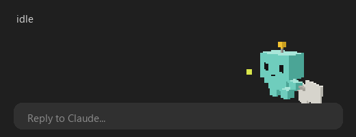

# piksel-maskot

A small 3D robot for the Claude desktop app on Windows. It stands on top of the message box in its own transparent window.

- Idle: bounces a tennis ball, reads a book, does jumping jacks, waves, or cracks a whip, in random order. It never sleeps.
- Working: types on a laptop.
- Needs your approval: raises an arm and shows a red "!".
- Finished a task that took at least a minute: jumps with confetti.
- Failed: shows a red X.
- Stopped a dangerous command: jumps with a red siren.

## Danger guard

When Claude tries to run a command that cannot be undone, the mod stops it before it runs and you decide. Examples: deleting your whole computer, user folders or project, `git push --force`, `git reset --hard`, `git clean`, dropping a database or table, formatting a disk, Docker volume deletion, registry deletion and shutting the computer down. It also understands chained, quoted and PowerShell forms.

- Where the app can ask you, it opens its own permission prompt. Only you can approve it, not auto-approve rules.
- Otherwise the command is refused and Claude explains the risk. If you type "I approve" (or "onaylıyorum") with the code Claude gives you, that exact command can run once within 10 minutes. Claude cannot unlock it by itself.
- Everyday work is not blocked: deleting `node_modules` or `dist`, deleting a single file, a normal push, `--force-with-lease`, installs and tests.

The guard is there to prevent accidents. It does not stop a deliberate workaround such as writing the command into a script file and running that.

## Requirements

- Windows and the Claude desktop app
- Python 3 with tkinter, with `pythonw` or `pyw` available (the python.org installer includes both)

## Install

From a shell:

`claude plugin install piksel-maskot --marketplace Hakanynyrt/piksel-maskot`

In the desktop app: click + next to the prompt box, then Plugins, Add marketplace with `Hakanynyrt/piksel-maskot`, then Add plugin.

Restart the app after installing. When a Claude Code session starts, the mod launches the robot window with Python. Only one robot runs at a time.

## Using it

- Drag the robot to fine-tune its position. The position is remembered.
- Right-click the robot to reset its position or close it.
- It follows the Claude window, hides when Claude is minimized, and stays behind other apps that cover Claude.

## Good to know

- The default position assumes the left sidebar is open. If you close the sidebar, drag the robot to the message box.
- Sessions that started before the install do not report their state until they are reopened.
- The approval animation can stay until the approved command ends, because the app does not report the moment you answer.
- The mod API it uses is in early access and may change between Claude Code releases.

This is an independent community project and is not affiliated with or endorsed by Anthropic.

## License

MIT
